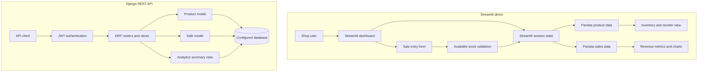
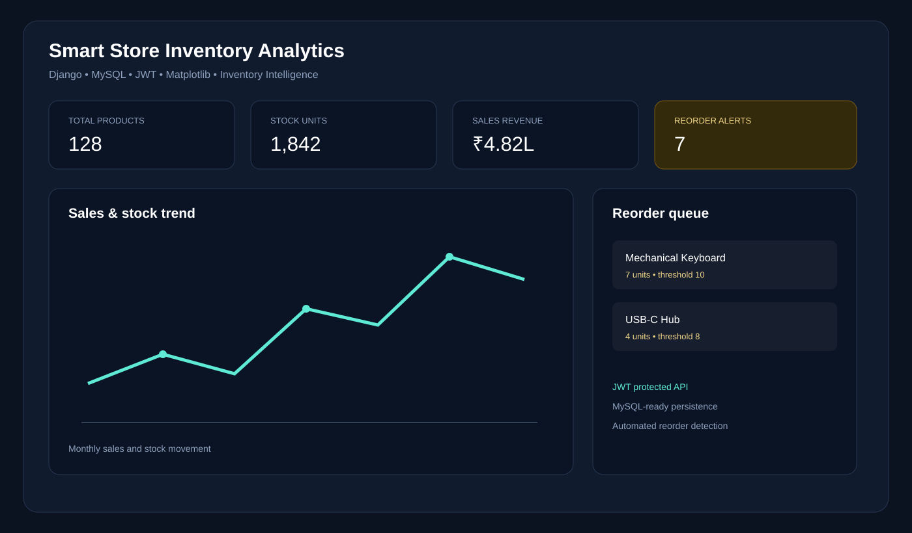
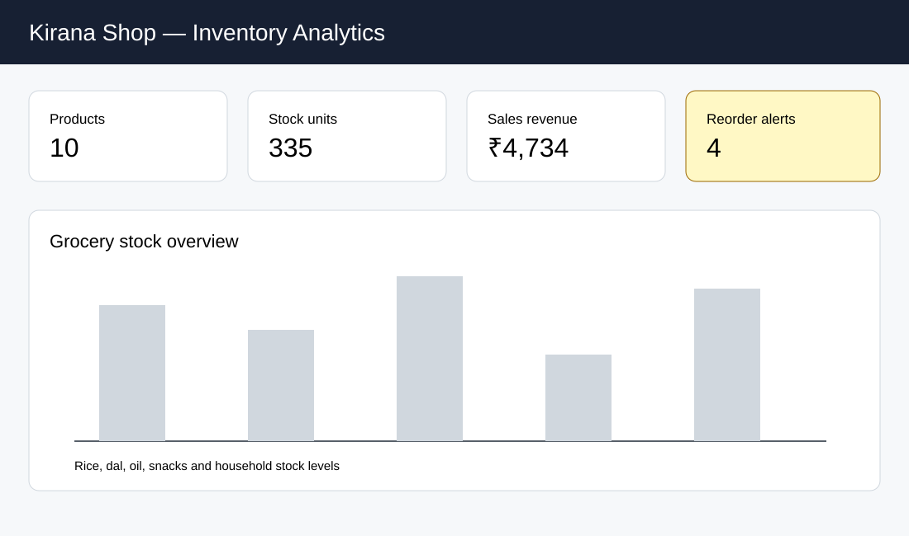
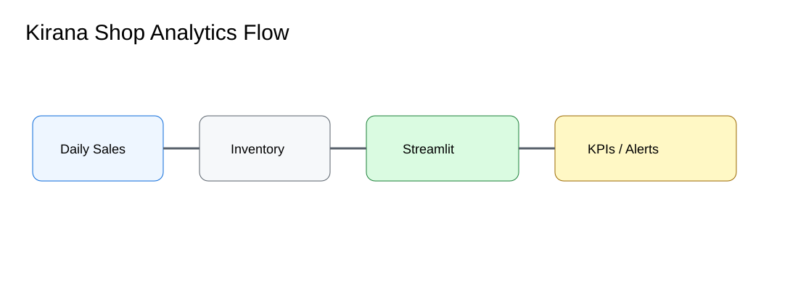
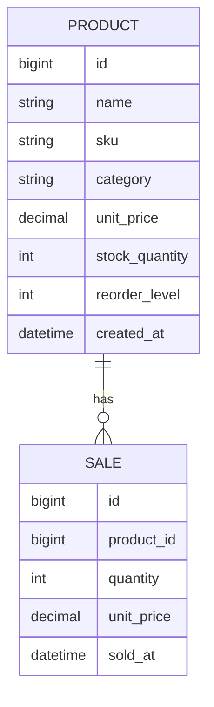

# Smart Store Inventory Analytics

A Python project for understanding and managing the basic inventory and sales activities of a small grocery store or kirana shop.

A shop owner handles many small but important tasks every day: checking whether rice and dal are available, noticing when cooking oil is running low, recording the quantity sold, and keeping track of the money earned from sales. When these details are maintained in separate notebooks or spreadsheets, it can become difficult to get a quick and reliable picture of the shop.

Smart Store Inventory Analytics explores a simple solution to that problem. It brings product information, stock levels, sales records, reorder alerts, and revenue summaries into a dashboard. The idea is to make everyday shop information easier to view and understand, without requiring the user to work with complicated reports.

The repository includes a Streamlit dashboard and a separate Django REST API implementation. The Streamlit application is the main interactive demo. The Django implementation shows how similar inventory and sales concepts can be represented through database models and REST API endpoints.

This is a portfolio and learning project, not a complete point-of-sale or production inventory system. The current scope and limitations are described below.

---

## Table of contents

- [The problem this project addresses](#the-problem-this-project-addresses)
- [Project goals](#project-goals)
- [What the application can do](#what-the-application-can-do)
- [Understanding the dashboard](#understanding-the-dashboard)
- [How a sale is processed](#how-a-sale-is-processed)
- [How reorder alerts work](#how-reorder-alerts-work)
- [How sales analytics are calculated](#how-sales-analytics-are-calculated)
- [Application architecture](#application-architecture)
- [Streamlit implementation](#streamlit-implementation)
- [Django REST API implementation](#django-rest-api-implementation)
- [Technology stack](#technology-stack)
- [Project structure](#project-structure)
- [Screenshots and visual references](#screenshots-and-visual-references)
- [Run the Streamlit dashboard](#run-the-streamlit-dashboard)
- [Run the Django REST API](#run-the-django-rest-api)
- [API reference](#api-reference)
- [Database design](#database-design)
- [Testing](#testing)
- [Current limitations](#current-limitations)
- [Future improvements](#future-improvements)
- [What I learned from this project](#what-i-learned-from-this-project)
- [Author](#author)

## The problem this project addresses

Inventory is one of the basic parts of running a retail shop. A shop needs to know what it has, how much is available, and which items are close to running out. Sales information is equally important because it helps the owner understand which products are being sold and how much revenue is being generated.

Consider a small grocery shop that sells rice, pulses, sugar, cooking oil, milk, biscuits, tea powder, and household products. During a busy day, several products may be sold in different quantities. If stock is not updated properly, the owner may think an item is available when it has already run out. If reorder levels are not monitored, the shop may notice a shortage only when a customer asks for that product.

This project demonstrates a basic digital workflow for those situations:

1. Keep product details and stock quantities in an organized list.
2. Find products using their name, SKU, or category.
3. Identify products whose stock has reached the reorder threshold.
4. Record sales and calculate their value.
5. Reflect the sale in the remaining stock in the Streamlit demo.
6. Review revenue information through summary metrics and charts.

The aim is not to replace a full accounting or billing platform. It is to demonstrate how a small business use case can be translated into a Python application.

## Project goals

The project was developed around a few practical goals:

- **Make inventory easier to understand:** show products, prices, categories, and available quantities together.
- **Make low stock visible:** compare current quantities with reorder levels and highlight products that need attention.
- **Connect sales with stock:** demonstrate how recording a sale affects the available quantity.
- **Present sales information clearly:** summarize revenue and display it through charts.
- **Explore Python application development:** use Streamlit for the user interface, Pandas for tabular data processing, and Django REST Framework for a separate API implementation.

## What the application can do

| Feature | Description | Why it is useful |
|---|---|---|
| Product catalog | Displays SKU, product name, category, unit, price, stock, and reorder level | Keeps product information organized |
| Product search | Searches by product name or SKU | Helps locate an item quickly |
| Category filter | Filters the inventory by selected categories | Makes a large product list easier to browse |
| Inventory summary | Shows product count and total stock units | Gives a quick view of the catalog and stock |
| Reorder alerts | Highlights products at or below their reorder level | Helps identify items that may need replenishment |
| Sale entry | Accepts a product and quantity to record a sale | Demonstrates a simple sales workflow |
| Stock deduction | Reduces stock after a valid sale in the Streamlit demo | Keeps the displayed inventory aligned with recorded demo sales |
| Revenue summary | Calculates the value of recorded sales | Gives a quick overview of sales value |
| Daily revenue chart | Displays revenue grouped by date | Helps compare sales across recorded dates |
| Category revenue chart | Displays revenue grouped by product category | Shows which categories contribute to recorded revenue |
| Django REST API | Exposes product, sales, and summary resources | Demonstrates a backend/API approach |

## Understanding the dashboard

The Streamlit dashboard is arranged so that a user can move from an overall view of the shop to individual inventory and sales tasks.

### 1. Dashboard summary

At the top of the dashboard, four metrics provide a quick summary:

- **Products:** the number of products in the currently filtered inventory.
- **Stock Units:** the sum of stock quantities for the currently filtered products. The quantities can represent kg, litres, packs, bars, or other product units, so this is a simple total rather than a conversion into one common physical unit.
- **Sales Entries:** the number of sale records currently loaded in the demo.
- **Total Revenue:** the sum of quantity multiplied by unit price across the loaded sales records.

The product count and stock units respond to the category and search filters. The sales entry count and revenue summarize the sales data loaded in the app.

### 2. Shop filters

The sidebar provides two ways to narrow the inventory:

- Select one or more product categories.
- Enter a product name or SKU in the search field.

For example, searching for `rice` shows products whose names contain that text. Searching for a SKU such as `KIR-1001` helps locate the exact catalog entry.

### 3. Inventory overview

The inventory table presents each product with its identifying information and current stock. A status is calculated from the stock quantity and reorder level:

- **Healthy:** stock is above the reorder level.
- **Reorder:** stock is equal to or below the reorder level.

This makes it easier to see which products need attention without checking every quantity manually.

### 4. Reorder alerts

The alert section lists products that have reached the reorder threshold. It shows the product name, remaining quantity, unit, and configured reorder level.

For example, if Toor Dal has 18 kg in stock and its reorder level is 20 kg, it appears in the alert list. This does not automatically place an order with a supplier; it simply informs the user that the stock level has reached the configured threshold.

### 5. Sales analytics

Two charts provide a basic view of the sales data:

- **Daily sales revenue:** groups sale values by date and displays them as a line chart.
- **Revenue by grocery category:** associates sales with product categories and displays category totals as a bar chart.

These charts are intended to make the sample sales data easier to interpret. They do not currently provide advanced forecasting, profit calculations, or supplier analysis.

### 6. Record a kirana sale

The sales form lets the user choose a product and enter the quantity sold. The product selector displays both the SKU and product name so the user can identify the correct item.

The form currently accepts a whole-number quantity from 1 to 100. The quantity is interpreted using the unit configured for that product. For example, a quantity of 2 could mean 2 kg of rice, 2 litres of milk, or 2 packs of biscuits.

After submission, the app checks the available stock. If the requested quantity is available, it records the sale, reduces stock, and refreshes the dashboard. If there is not enough stock, it displays an error and does not record the sale.

## How a sale is processed

The Streamlit sale workflow is designed to show the relationship between a sales transaction and inventory.

Suppose the shop has 18 units of a product and the customer buys 3 units.

Before the sale:

| Detail | Value |
|---|---:|
| Available stock | 18 |
| Quantity requested | 3 |
| Unit price | ₹145 |

The application checks that the requested quantity is not greater than the available stock. If the check passes, it calculates the sale value and updates the data.

| Calculation | Result |
|---|---:|
| Sale value: 3 × ₹145 | ₹435 |
| Remaining stock: 18 − 3 | 15 |

The general calculations are:

```text
sale_value = quantity_sold * unit_price
remaining_stock = available_stock - quantity_sold
```

In the Streamlit implementation, the new sale is appended to the sales DataFrame held in session state, and the product's stock value is updated in the products DataFrame.

The Django API has a separate sale-creation implementation. Its current stock update behavior and validation limitation are explained in the Django section below.

## How reorder alerts work

Each product has a configured reorder level. This is the stock quantity at which the shop should consider replenishing the item.

The rule used in both the project concept and the Django Product model is:

```text
needs_reorder = stock_quantity <= reorder_level
```

Example:

| Product | Current stock | Reorder level | Status |
|---|---:|---:|---|
| Sona Masoori Rice | 85 kg | 25 kg | Healthy |
| Toor Dal | 18 kg | 20 kg | Reorder |
| Sunflower Oil | 12 litres | 15 litres | Reorder |
| Milk | 9 litres | 12 litres | Reorder |

The threshold is configurable per product. Different products can have different reorder levels because some items sell faster than others or take longer to replenish.

An alert is only an indication that stock has reached the threshold. Supplier management, purchase orders, and automatic replenishment are not part of the current implementation.

## How sales analytics are calculated

The dashboard uses the sales records to calculate revenue.

For each sale:

```text
line_revenue = quantity * unit_price
```

Total revenue is the sum of the revenue values for all loaded sale records:

```text
total_revenue = sum(quantity * unit_price for each sale)
```

The daily chart groups these values by the sale date. The category chart joins the sales records with the product catalog using SKU, then groups the revenue by category.

A few distinctions are important:

- Revenue is not the same as profit. The current project does not store purchase cost or operating expenses.
- The dashboard does not currently calculate tax, discounts, returns, or payment methods.
- The charts summarize the sales records available in the current demo session; they are not connected to a live shop database.

## Application architecture

The repository contains two related but independent application paths.



**The two paths do not currently share data.** Streamlit uses its own sample DataFrames in session state. Django reads and writes records in its configured database. The diagram intentionally shows them as separate paths; connecting them is a possible future improvement.

## Streamlit implementation

The main dashboard is implemented in `streamlit_app.py`.

### Data representation

The demo uses two Pandas DataFrames:

- `products`: contains the sample product catalog.
- `sales`: contains the sample sales history.

The product data includes fields such as SKU, product name, category, unit, price, stock, and reorder level. The sales data includes date, SKU, product name, quantity, and unit price.

### Session state

The application initializes `st.session_state.products` and `st.session_state.sales` when those values are not already present. This allows changes made during an active Streamlit session to remain available as the app reruns.

Session state is not a permanent database. Data can be lost when the session is reset or the app environment restarts. This is why the Streamlit version is suitable as a self-contained demo, but should not be used as the only record-keeping system for a real shop.

### Filtering and calculations

Pandas is used to filter products by category and search text. It is also used to calculate sales revenue, group revenue by date, and combine sales with product categories for the category chart.

### Sale validation

Before updating stock, the app compares the requested quantity with the available quantity. If the request is too large, the sale is rejected in the Streamlit workflow. Otherwise, the stock DataFrame is updated and a new row is appended to the sales DataFrame.

## Django REST API implementation

The Django implementation provides a separate backend structure for product inventory, sales records, and analytics.

### Inventory app

The `inventory` app contains the Product model, serializer, and viewset.

The Product model stores:

- `name`: product name.
- `sku`: unique stock keeping unit.
- `category`: product category.
- `unit_price`: price per unit.
- `stock_quantity`: current stock quantity.
- `reorder_level`: stock threshold for reorder alerts.
- `created_at`: record creation timestamp.

The model includes a `needs_reorder()` method that returns true when the stock quantity is less than or equal to the reorder level.

The ProductSerializer exposes the model fields and a read-only `needs_reorder` value. The ProductViewSet is based on DRF's ModelViewSet, providing standard list, create, retrieve, update, and delete operations. Product API access requires authentication through the configured REST framework defaults.

### Sales app

The `sales` app contains the Sale model, serializer, and viewset.

A Sale record is linked to a Product through a foreign key. It stores the quantity sold, the unit price recorded for that sale, and the timestamp when the record was created. Its `total` property calculates quantity multiplied by unit price.

The SaleViewSet provides standard sale API operations. When a sale is created, its current implementation saves the sale and then reduces the associated product's stock quantity.

**Current backend validation limitation:** the Django sale creation code currently clamps the resulting stock to zero using `max(0, stock_quantity - quantity)`. It does not reject a sale when the requested quantity is greater than the available stock. As a result, the API can record an over-sale while setting stock to zero. This should be corrected before using the API for real inventory transactions. The current implementation also does not wrap sale creation and stock deduction in a database transaction.

### Analytics app

The `analytics` app provides a summary endpoint. It queries the Product and Sale models and returns:

- product count;
- total units in stock;
- number of sale records;
- total revenue calculated from quantity and unit price;
- products whose stock quantity is at or below their reorder level.

The summary is calculated from Django database records. It is separate from the Streamlit dashboard's in-memory sample data.

### Authentication and settings

The Django project configures JWT authentication through Django REST Framework Simple JWT. The global default permission class is `IsAuthenticated`, so API requests require authentication unless a view explicitly overrides that behavior.

The token endpoints are configured in the main URL configuration. The settings load environment variables from a local `.env` file using python-dotenv. SQLite is the default database engine, while the database engine and connection values can be configured using environment variables.

The current settings are suitable for local development, not direct production deployment. In particular, the development secret-key fallback, debug setting, and permissive allowed-host configuration must be replaced with secure deployment-specific values before public hosting.

## Technology stack

| Technology | Role in this project |
|---|---|
| Python | Main programming language |
| Streamlit | Builds the interactive dashboard |
| Pandas | Stores, filters, joins, and summarizes tabular demo data |
| Django | Backend web framework for the API implementation |
| Django REST Framework | Serializers, viewsets, and REST API endpoints |
| Simple JWT | Token-based API authentication |
| SQLite | Default local development database |
| MySQL | Optional database engine configured through environment variables |
| python-dotenv | Loads local environment configuration |
| GitHub | Source control and project hosting |

## Project structure

```text
smart-store-inventory-analytics/
├── streamlit_app.py           # Main Streamlit dashboard
├── requirements.txt           # Streamlit and Pandas dependencies
├── requirements-django.txt    # Django/API dependencies
├── manage.py                  # Django management entry point
├── config/
│   ├── settings.py             # Django settings and database configuration
│   ├── urls.py                 # Main URL configuration
│   ├── asgi.py                 # ASGI entry point
│   └── wsgi.py                 # WSGI entry point
├── inventory/
│   ├── models.py               # Product model
│   ├── serializers.py          # Product serializer
│   ├── views.py                # Product API viewset
│   └── urls.py                 # Product API routes
├── sales/
│   ├── models.py               # Sale model
│   ├── serializers.py          # Sale serializer
│   ├── views.py                # Sale API and stock update logic
│   └── urls.py                 # Sales API routes
├── analytics/
│   ├── views.py                # Inventory and sales summary
│   └── urls.py                 # Analytics route
├── templates/                  # Basic Django HTML templates
├── fixtures/                   # Fixture data, if used
├── tests/                      # Django tests
├── docs/
│   ├── API.md                  # API notes
│   ├── database.md             # Database setup notes
│   └── screenshots/            # Documentation illustrations
└── .github/
    └── workflows/              # GitHub Actions workflows
```

## Screenshots and visual references

The repository includes three visual assets to help readers understand the intended dashboard areas. These are documentation illustrations/mockups, not screenshots captured from a live deployment.

### Product overview



### Inventory dashboard



### Analytics overview



## Run the Streamlit dashboard

The Streamlit application is the quickest way to try the project. It uses sample data and does not require a database server.

### 1. Clone the repository

```bash
git clone https://github.com/ankitha768/smart-store-inventory-analytics.git
cd smart-store-inventory-analytics
```

### 2. Create a virtual environment

**Windows PowerShell:**

```powershell
python -m venv .venv
.venv\Scripts\Activate.ps1
```

**Windows Command Prompt:**

```bat
python -m venv .venv
.venv\Scripts\activate.bat
```

**macOS or Linux:**

```bash
python3 -m venv .venv
source .venv/bin/activate
```

### 3. Install dependencies

```bash
python -m pip install --upgrade pip
pip install -r requirements.txt
```

### 4. Run the dashboard

```bash
streamlit run streamlit_app.py
```

Open the local address printed in the terminal. Streamlit commonly uses [http://localhost:8501](http://localhost:8501).

## Deploy the Streamlit dashboard

The Streamlit app can be deployed using [Streamlit Community Cloud](https://share.streamlit.io/).

1. Sign in to Streamlit Community Cloud.
2. Connect the GitHub account that has access to this repository.
3. Create a new app and select `ankitha768/smart-store-inventory-analytics`.
4. Select the `main` branch.
5. Set the main file path to `streamlit_app.py`.
6. Deploy the app.

The Streamlit demo does not need the Django server or a MySQL database. Remember that its session-state data is temporary and should not be treated as permanent shop records.

## Run the Django REST API

The Django backend is a separate part of the repository. Use its own dependency file rather than the Streamlit requirements file.

### 1. Install dependencies

Activate a virtual environment and run:

```bash
pip install -r requirements-django.txt
```

### 2. Configure environment variables

Review `.env.example` and `config/settings.py`. The project uses SQLite by default. To use MySQL, configure the database engine and connection values supported by the settings:

- `DB_ENGINE`
- `DB_NAME`
- `DB_USER`
- `DB_PASSWORD`
- `DB_HOST`
- `DB_PORT`

Keep credentials and production secrets private. Do not commit a real `.env` file containing passwords or secret keys.

### 3. Create database tables

```bash
python manage.py makemigrations
python manage.py migrate
```

### 4. Start the development server

```bash
python manage.py runserver
```

The Django development server normally runs at [http://127.0.0.1:8000](http://127.0.0.1:8000).

## API reference

The Django API uses router-based endpoints for products and sales.

| Method | Endpoint | Purpose |
|---|---|---|
| POST | `/api/token/` | Obtain JWT access and refresh tokens |
| POST | `/api/token/refresh/` | Refresh an access token |
| GET | `/api/products/` | List products |
| POST | `/api/products/` | Create a product |
| GET | `/api/products/{id}/` | Retrieve one product |
| PUT / PATCH | `/api/products/{id}/` | Update a product |
| DELETE | `/api/products/{id}/` | Delete a product |
| GET | `/api/sales/` | List sales |
| POST | `/api/sales/` | Create a sale |
| GET | `/api/sales/{id}/` | Retrieve one sale |
| PUT / PATCH | `/api/sales/{id}/` | Update a sale record |
| DELETE | `/api/sales/{id}/` | Delete a sale record |
| GET | `/api/analytics/summary/` | Get inventory and sales summary |

The product and sales endpoints are generated by Django REST Framework routers. The exact API behavior follows the serializers and viewsets in the respective apps.

### Obtain an access token

Send a POST request to `/api/token/` with the credentials of a Django user:

```json
{
  "username": "your_username",
  "password": "your_password"
}
```

The response contains an access token and a refresh token. Use the access token in the authorization header for protected API requests:

```http
Authorization: Bearer <access_token>
```

When the access token expires, send the refresh token to `/api/token/refresh/` to obtain a new access token.

### Example: create a product

A product creation request uses the product fields accepted by the ProductSerializer. For example:

```json
{
  "name": "Toor Dal",
  "sku": "KIR-1002",
  "category": "Pulses",
  "unit_price": "145.00",
  "stock_quantity": 18,
  "reorder_level": 20
}
```

### Example: create a sale

A sale request refers to an existing product by its database ID:

```json
{
  "product": 1,
  "quantity": 2,
  "unit_price": "145.00"
}
```

The current SaleViewSet saves the sale and reduces the related product's stock. As noted earlier, the backend currently does not reject a quantity larger than available stock. Add server-side validation and transaction handling before using this endpoint for real sales.

For the concise API notes in the repository, see [docs/API.md](docs/API.md).

## Database design

The Django implementation uses two main business models.

### Product

A Product represents an item maintained in the shop catalog.

| Field | Type / purpose |
|---|---|
| `id` | Database-generated primary key |
| `name` | Product name |
| `sku` | Unique stock keeping unit |
| `category` | Product category |
| `unit_price` | Decimal unit price |
| `stock_quantity` | Non-negative integer stock quantity |
| `reorder_level` | Non-negative integer reorder threshold |
| `created_at` | Automatically recorded creation timestamp |

### Sale

A Sale represents a sale record associated with a product.

| Field | Type / purpose |
|---|---|
| `id` | Database-generated primary key |
| `product` | Foreign key to Product |
| `quantity` | Positive integer quantity sold |
| `unit_price` | Decimal unit price stored for the sale |
| `sold_at` | Automatically recorded sale timestamp |
| `total` | Read-only calculated property: quantity multiplied by unit price |

A product can have multiple sale records. The foreign key uses a protected delete behavior, so a product that has related sales cannot simply be deleted while those references remain.



The Django database configuration uses SQLite for local development by default. MySQL can be selected through the environment variables described in `docs/database.md`.

## Testing

The repository contains a Django test directory. After installing the Django dependencies and configuring the project, run:

```bash
python manage.py test
```

The test suite should be expanded as the application grows. Important cases include product creation and updates, authentication and permissions, stock threshold calculations, valid sales, rejected over-sales, and analytics totals.

## Current limitations

The project demonstrates the core workflow, but several parts are intentionally simple and should be improved before the application is used in a real shop.

1. **Temporary Streamlit data:** product and sales changes are stored in Streamlit session state. They are not persisted in a permanent database.
2. **Separate application paths:** the Streamlit dashboard does not call the Django API. The two implementations do not synchronize products or sales.
3. **Backend over-sale validation:** the Django sale endpoint currently reduces stock with a zero lower bound rather than rejecting a sale that exceeds available stock.
4. **Transaction safety:** sale creation and stock deduction are not currently wrapped in an atomic database transaction.
5. **Basic analytics:** the project calculates revenue, not profit. It does not include purchase cost, expenses, taxes, discounts, returns, or payment reconciliation.
6. **No supplier workflow:** reorder alerts identify products that need attention but do not create purchase orders or contact suppliers.
7. **Development configuration:** the Django settings contain development defaults. Secure secret management, restricted hosts, and production settings are required before public deployment.
8. **Testing coverage:** the project would benefit from more automated tests for important business rules and API edge cases.

## Future improvements

There are several practical ways to take this project further:

- Connect the Streamlit dashboard to the Django REST API so both use the same product and sales records.
- Store all application data in a persistent database and add backup and recovery procedures.
- Add robust backend validation to reject invalid sales and prevent negative inventory.
- Use database transactions and concurrency-safe updates when multiple users record sales at the same time.
- Add product creation, editing, deletion, and stock adjustment workflows to the dashboard.
- Add supplier details, purchase orders, and a purchase/restocking workflow.
- Add date-range filters and reports for daily, weekly, and monthly sales.
- Track cost price and calculate gross profit in addition to revenue.
- Add discounts, returns, taxes, and payment methods if the project is extended into a billing workflow.
- Add role-based access for shop owners and employees.
- Improve API documentation and expand automated tests.
- Align Docker and CI workflows with the application and dependency set being deployed.

## What I learned from this project

This project brings together several concepts that are useful when building a small business application:

- Structuring tabular product and sales data with Pandas.
- Building an interactive dashboard with Streamlit.
- Filtering data and calculating summary values from records.
- Connecting a sales operation to an inventory update.
- Presenting business information through charts and key metrics.
- Designing Django models and relationships for products and sales.
- Creating REST endpoints using Django REST Framework serializers, viewsets, and routers.
- Protecting API endpoints with JWT authentication.
- Thinking about data persistence, validation, and transaction safety.

The project also highlights an important part of application development: a feature that works in a small demo may need additional validation, persistence, and security before it is suitable for real business use.

## Author

**Ankitha**

- GitHub: [@ankitha768](https://github.com/ankitha768)
- Project repository: [smart-store-inventory-analytics](https://github.com/ankitha768/smart-store-inventory-analytics)

---

This project is a practical exploration of inventory management and sales analytics for a small retail business. Suggestions and feedback are welcome.
