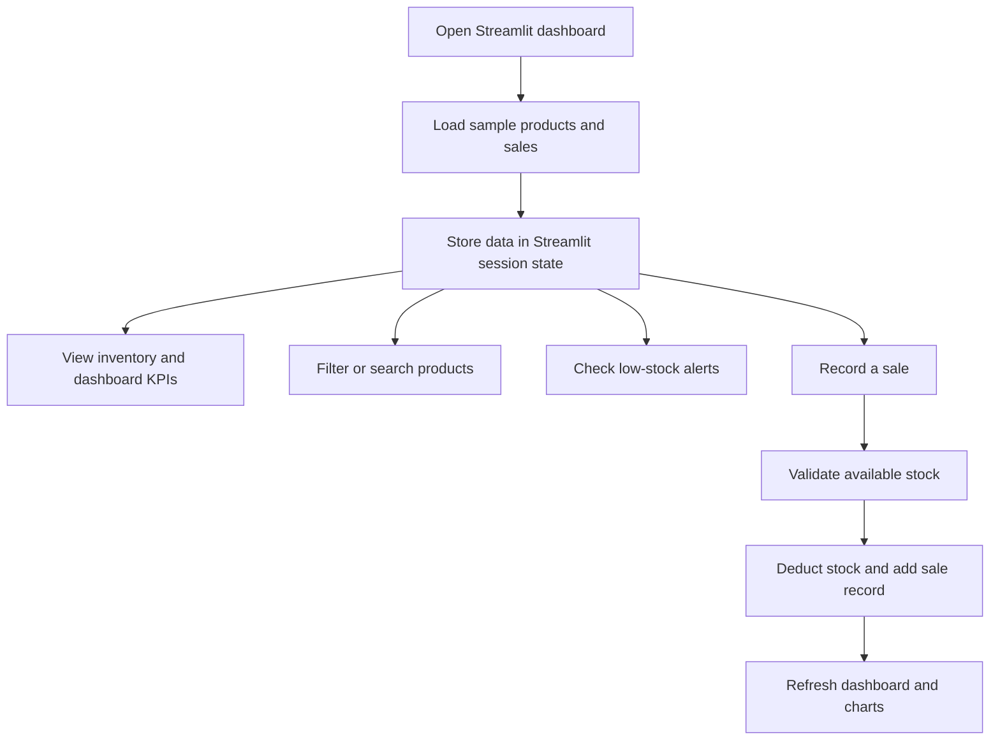
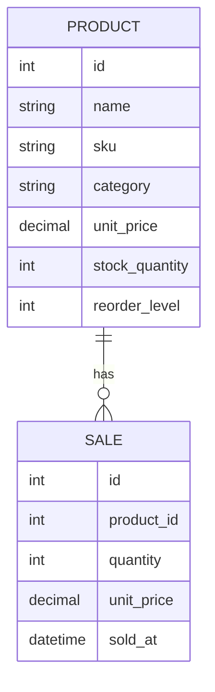

# Smart Store Inventory Analytics

A Python-based inventory and sales analytics project designed for a small Indian grocery (kirana) store. It provides a simple dashboard to manage grocery products, monitor stock, record sales, identify items that need reordering, and understand revenue trends.

The repository contains **two implementations**:

1. **Streamlit dashboard** — the primary, easy-to-run demo.
2. **Django REST API** — the original backend implementation, retained for API and backend learning.

> **Important:** The Streamlit dashboard and Django backend are separate implementations. The Streamlit app uses sample data stored in Streamlit session state; it is not currently connected to the Django database.

---

## Table of contents

- [Project at a glance](#project-at-a-glance)
- [Screenshots](#screenshots)
- [Features](#features)
- [How the Streamlit app works](#how-the-streamlit-app-works)
- [Technology stack](#technology-stack)
- [Repository structure](#repository-structure)
- [Run the Streamlit application](#run-the-streamlit-application)
- [Django REST API setup](#django-rest-api-setup)
- [API endpoints](#api-endpoints)
- [Data model](#data-model)
- [Tests](#tests)
- [Current limitations and future improvements](#current-limitations-and-future-improvements)

## Project at a glance

A kirana shop needs to know what products are available, what is selling, how much revenue is being generated, and which products should be reordered. This project demonstrates those everyday tasks through an inventory dashboard and a sales analytics view.

| Area | What it does |
|---|---|
| Product inventory | Displays products, categories, prices, available stock, and reorder levels |
| Product discovery | Filters by category and searches by product name or SKU |
| Sales recording | Records a sale and updates the available stock in the Streamlit demo |
| Reorder monitoring | Flags products whose stock is at or below their reorder level |
| Sales analytics | Shows revenue trends by day and revenue by product category |
| Summary metrics | Displays product count, stock units, sales entries, and total revenue |

## Screenshots

The repository includes these visual assets. They are documentation illustrations/mockups rather than screenshots captured from a live deployment.

### Product overview


### Inventory dashboard


### Analytics overview


## Features

- Grocery-oriented sample catalog, including rice, dal, sugar, oil, salt, atta, biscuits, milk, tea, and soap.
- Product details such as SKU, category, unit price, stock quantity, and reorder level.
- Search by product name or SKU, with category filtering.
- Dashboard KPIs for products, stock units, sales entries, and revenue.
- Low-stock alerts when available stock is less than or equal to the reorder threshold.
- Sale-entry workflow that checks available stock, records the sale, and deducts the sold quantity in the Streamlit app.
- Daily revenue line chart and category-wise revenue chart.
- Indian Rupee (₹) pricing in the sample dashboard.

## How the Streamlit app works

The Streamlit app is the quickest way to explore the project.



### Dashboard metrics

- **Products:** number of products in the catalog.
- **Stock units:** sum of the available stock quantities.
- **Sales entries:** number of recorded sale transactions.
- **Total revenue:** sum of the recorded sales' values.

### Reorder rule

A product is marked for reorder when:

```text
stock_quantity <= reorder_level
```

### Sale calculation

For a sale with a quantity and unit price:

```text
sale_total = quantity × unit_price
remaining_stock = current_stock - quantity
```

The Streamlit workflow checks that the requested quantity is available before recording the sale.

## Technology stack

| Technology | Purpose |
|---|---|
| Python | Application language |
| Streamlit | Interactive dashboard |
| Pandas | Tabular product and sales data |
| Django | Backend framework for the retained API implementation |
| Django REST Framework | REST API |
| Simple JWT | JWT authentication for the API |
| SQLite | Default Django development database |
| MySQL | Optional database configuration in Django settings |

## Repository structure

```text
smart-store-inventory-analytics/
├── streamlit_app.py          # Main Streamlit dashboard
├── requirements.txt           # Streamlit app dependencies
├── requirements-django.txt    # Django/API dependencies
├── manage.py                  # Django management entry point
├── config/                    # Django project settings and URLs
├── inventory/                 # Product model, serializer, and API
├── sales/                     # Sale model, serializer, and API
├── analytics/                 # Analytics summary API
├── templates/                 # Basic HTML templates
├── fixtures/                  # Fixture data, if used
├── tests/                     # Django tests
├── docs/
│   ├── API.md                 # API notes
│   ├── database.md            # Database notes
│   └── screenshots/           # Documentation illustrations
└── .github/
    └── workflows/             # GitHub Actions workflow
```

## Run the Streamlit application

### 1. Clone the repository

```bash
git clone https://github.com/ankitha768/smart-store-inventory-analytics.git
cd smart-store-inventory-analytics
```

### 2. Create and activate a virtual environment

**Windows (PowerShell):**

```powershell
python -m venv .venv
.venv\Scripts\Activate.ps1
```

**Windows (Command Prompt):**

```bat
python -m venv .venv
.venv\Scripts\activate.bat
```

**macOS / Linux:**

```bash
python3 -m venv .venv
source .venv/bin/activate
```

### 3. Install the Streamlit dependencies

```bash
python -m pip install --upgrade pip
pip install -r requirements.txt
```

### 4. Start the dashboard

```bash
streamlit run streamlit_app.py
```

Open the local URL printed in the terminal (usually [http://localhost:8501](http://localhost:8501)).

### Deploy with Streamlit Community Cloud

1. Sign in to [Streamlit Community Cloud](https://share.streamlit.io/).
2. Create a new app and connect your GitHub account.
3. Choose the repository `ankitha768/smart-store-inventory-analytics`.
4. Select the `main` branch.
5. Set the app's main file path to `streamlit_app.py`.
6. Deploy the app.

The Streamlit demo does not require a MySQL server or Django setup.

## Django REST API setup

The Django implementation is included as a separate backend/API path. It has its own dependency file.

### 1. Install Django dependencies

Activate a virtual environment, then run:

```bash
pip install -r requirements-django.txt
```

### 2. Configure environment variables

Review `.env.example` and `config/settings.py`. The project uses SQLite by default; MySQL can be configured through the supported environment variables in the settings file.

Do not commit real passwords, secret keys, or other credentials to the repository.

### 3. Apply migrations and start the server

```bash
python manage.py migrate
python manage.py runserver
```

The Django development server normally runs at [http://127.0.0.1:8000](http://127.0.0.1:8000).

### Authentication

The Django REST API is configured to use JWT authentication and authenticated access by default. Obtain an access token from the token endpoint and include it in requests:

```http
Authorization: Bearer <access_token>
```

## API endpoints

The Django backend exposes the following main route groups (the exact router-generated product and sale routes are defined in their respective app URL configurations).

| Endpoint | Purpose |
|---|---|
| `/api/token/` | Obtain a JWT access/refresh token pair |
| `/api/token/refresh/` | Refresh an access token |
| `/api/inventory/` | Product inventory API |
| `/api/sales/` | Sales API |
| `/api/analytics/summary/` | Inventory and sales summary |

For detailed request/response examples, see [docs/API.md](docs/API.md).

## Data model

The Django implementation uses two main business entities.

### Product

| Field | Description |
|---|---|
| `name` | Product name |
| `sku` | Unique stock keeping unit |
| `category` | Product category |
| `unit_price` | Price per unit |
| `stock_quantity` | Current stock quantity |
| `reorder_level` | Stock threshold for reorder alerts |
| `created_at` | Record creation timestamp |

### Sale

| Field | Description |
|---|---|
| `product` | Related product |
| `quantity` | Quantity sold |
| `unit_price` | Unit price recorded for the sale |
| `sold_at` | Sale timestamp |
| `total` | Calculated sale value (`quantity × unit_price`) |

The relationship is one-to-many: one product can be associated with multiple sale records.



## Tests

The repository includes Django tests under the `tests/` directory. To run the Django test suite after installing the Django dependencies:

```bash
python manage.py test
```

## Current limitations and future improvements

The project is a learning/portfolio implementation. Before using it to operate a real shop, consider the following improvements:

- Persist Streamlit products and sales in a database instead of session state.
- Connect the Streamlit dashboard to the Django API, or consolidate the project around one data layer.
- Add server-side validation to reject sales that exceed available stock.
- Use database transactions and concurrency-safe stock updates when recording sales.
- Add more tests for API permissions, product CRUD, sale validation, and analytics calculations.
- Add pagination, input validation, error handling, and API documentation.
- Review and align Docker and CI dependency installation with the Django or Streamlit run target.

### Data and security notes

- Streamlit session-state data is temporary and is not a permanent database record.
- The sample product catalog and sales are illustrative; they are not live shop data.
- The Django backend uses a database separately from the Streamlit demo.
- Use environment variables for secrets and database credentials.

## Author

**Ankitha**

- GitHub: [@ankitha768](https://github.com/ankitha768)
- Project repository: [smart-store-inventory-analytics](https://github.com/ankitha768/smart-store-inventory-analytics)

---

If you find this project useful, feel free to explore the code, run the dashboard, and suggest improvements.
