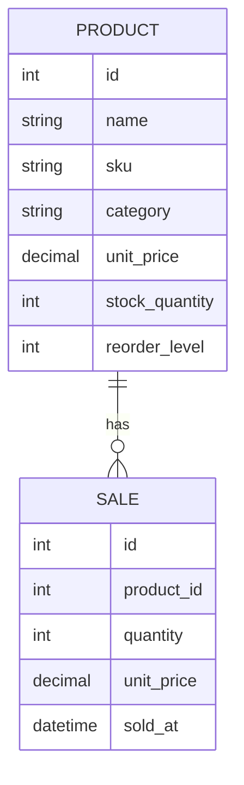

# Smart Store Inventory Analytics

A simple inventory and sales analytics application built around the day-to-day needs of a small grocery store or kirana shop.

Running a small shop involves more than selling products. The shop owner has to keep track of available stock, notice when popular items are running low, record sales, and understand how much revenue the shop is generating. When this information is scattered across notebooks or spreadsheets, it can take time to get a clear picture of the business.

This project explores how a small digital dashboard can bring those details together in one place. It provides an inventory view, low-stock alerts, a simple sales-entry workflow, and charts that help make sales information easier to understand.

The project is intended as a Python portfolio and learning project. It currently includes a Streamlit dashboard for trying the workflow and a separate Django REST API implementation for exploring backend development.

---

## Why I built this project

I wanted to work on a practical problem rather than build an application that only displays data. A grocery shop is a familiar example of a business where inventory and sales information are closely connected.

For example, imagine a shop that sells rice, dal, oil, milk, biscuits, and other everyday items. The owner should be able to answer a few basic questions without checking several notebooks:

- Which products are currently available, and how much stock is left?
- Which items have reached the point where they should be reordered?
- What happens to the stock quantity when a sale is recorded?
- How much revenue have the recorded sales generated?
- Which dates or product categories contributed to sales?

The dashboard brings these questions into a single view. It is designed to be straightforward to explore, even for someone who is not familiar with inventory software.

## What the application does

The main dashboard is organized around the typical tasks involved in managing a small shop.

### 1. View and search the inventory

The inventory section displays the products in the sample catalog. Each product has a stock keeping unit (SKU), name, category, unit of measurement, price, available quantity, and reorder level.

A shop owner can narrow the list by category or search using a product name or SKU. This makes it easier to find a particular item when the product list grows.

### 2. Keep an eye on low stock

Every product has a reorder level. The application compares the current stock quantity with that threshold.

A product is marked for reorder when:

```text
current stock <= reorder level
```

For example, if the shop has 18 kg of Toor Dal and its reorder level is 20 kg, the dashboard highlights it as a product that needs attention. This is a simple way to notice items that may need replenishment before they run out.

### 3. Record a sale and update stock

The sales form lets the user select a product and enter the quantity sold. Before saving the sale, the Streamlit application checks whether enough stock is available.

If the requested quantity is available, the application:
1. Adds a new entry to the sales data.
2. Calculates the sale value using the product's unit price and quantity.
3. Reduces the available stock by the quantity sold.
4. Refreshes the dashboard so the updated figures are visible.

If the requested quantity is greater than the available stock, the application displays an error instead of recording that sale.

The basic calculation is:

```text
sale value = quantity sold × unit price
remaining stock = previous stock - quantity sold
```

This keeps the sales-entry example connected to the inventory view: recording a sale changes the stock shown on the dashboard.

### 4. Understand sales through charts

The analytics section turns the recorded sales into two simple views:

- **Daily revenue:** a line chart that shows how recorded revenue changes from one date to another.
- **Revenue by category:** a bar chart that groups sales revenue by grocery category.

The dashboard also displays four summary figures: number of products, total stock units, number of sales entries, and total recorded revenue. Together, these figures provide a quick overview before looking at individual products or charts.

## Screenshots and visual references

The repository includes three visual assets to illustrate the main areas of the project. They are documentation mockups, not screenshots captured from a running deployment.

### Product overview


### Inventory dashboard


### Analytics overview


## A typical user journey

A normal session with the Streamlit demo might look like this:

1. Open the dashboard and review the product count, stock units, sales entries, and revenue.
2. Search for a product or filter the inventory by category.
3. Check the reorder alerts and identify products whose stock has reached the reorder level.
4. Select a product in the sales form and enter the quantity sold.
5. Submit the sale. If enough stock is available, the application records it and reduces the stock quantity.
6. Review the updated inventory and sales charts.

This is the central idea of the project: inventory and sales should be viewed together, because a sale affects the amount of stock remaining in the shop.

## How the project is organized

There are two implementations in this repository. They demonstrate related functionality, but they do not currently share the same data source.

### Streamlit dashboard

The Streamlit application is the easiest way to run and explore the project. Its main file is `streamlit_app.py`.

It uses Pandas DataFrames for the sample product and sales records. Streamlit's session state keeps changes available while the current app session is active. This makes the demo self-contained: you do not need to configure a database just to try the dashboard.

The Streamlit dashboard is the primary interactive demonstration of the project. It includes product search, category filters, inventory metrics, reorder alerts, charts, and the sale-entry form.

### Django REST API

The repository also contains a Django REST Framework implementation. This part demonstrates how the inventory and sales concepts can be represented as backend models and exposed through API endpoints.

The main Django components are:

- **Inventory app:** defines the Product model and product-related API functionality.
- **Sales app:** defines the Sale model and sales-related API functionality.
- **Analytics app:** provides an endpoint for an inventory and sales summary.
- **Config package:** contains the Django project settings and URL configuration.

The Django Product model stores information such as the product name, SKU, category, unit price, stock quantity, and reorder level. The Sale model refers to a product and stores the quantity sold, the unit price, and the sale timestamp.

The Django backend uses its own database configuration. SQLite is the default development option, and the settings also contain optional MySQL configuration.

**Important:** The Streamlit dashboard is not currently connected to the Django REST API or its database. The two implementations run independently. A sale entered in Streamlit does not create a Django Sale record, and changes made through the Django API do not appear in the Streamlit dashboard.

## Technology used

| Technology | How it is used |
|---|---|
| Python | Main programming language |
| Streamlit | Builds the interactive inventory and analytics dashboard |
| Pandas | Stores and processes the demo product and sales tables |
| Django | Provides the separate backend implementation |
| Django REST Framework | Exposes inventory, sales, and analytics through REST APIs |
| Simple JWT | Provides token-based authentication for the Django API |
| SQLite | Default database for local Django development |
| MySQL | Optional database configuration in the Django settings |

## Repository structure

```text
smart-store-inventory-analytics/
├── streamlit_app.py           # Main Streamlit dashboard
├── requirements.txt           # Streamlit app dependencies
├── requirements-django.txt    # Django and API dependencies
├── manage.py                  # Django management entry point
├── config/                    # Django settings and URL configuration
├── inventory/                 # Product model, serializer, and API
├── sales/                     # Sale model, serializer, and API
├── analytics/                 # Analytics summary API
├── templates/                 # Basic HTML templates
├── fixtures/                  # Fixture data, if used
├── tests/                     # Django tests
├── docs/
│   ├── API.md                 # API notes and examples
│   ├── database.md            # Database notes
│   └── screenshots/           # Documentation illustrations
└── .github/
    └── workflows/             # GitHub Actions workflows
```

## Run the Streamlit dashboard

You can run the interactive dashboard locally with Python. The Streamlit version does not require a database server.

### 1. Clone the repository

```bash
git clone https://github.com/ankitha768/smart-store-inventory-analytics.git
cd smart-store-inventory-analytics
```

### 2. Create a virtual environment

**Windows (PowerShell):**

```powershell
python -m venv .venv
.venv\Scripts\Activate.ps1
```

**Windows (Command Prompt):**

```bat
python -m venv .venv
.venv\Scripts\activate.bat
```

**macOS or Linux:**

```bash
python3 -m venv .venv
source .venv/bin/activate
```

### 3. Install the dependencies

```bash
python -m pip install --upgrade pip
pip install -r requirements.txt
```

### 4. Start the application

```bash
streamlit run streamlit_app.py
```

Streamlit will print a local address in the terminal. Open it in your browser; the default address is usually [http://localhost:8501](http://localhost:8501).

## Deploy the Streamlit app

The Streamlit dashboard can be deployed using Streamlit Community Cloud:

1. Sign in to [Streamlit Community Cloud](https://share.streamlit.io/).
2. Connect your GitHub account if it is not already connected.
3. Create a new app and select this repository.
4. Choose the `main` branch.
5. Set the main file path to `streamlit_app.py`.
6. Deploy the application.

The Streamlit demo uses sample data and does not need a MySQL server or a running Django backend.

## Run the Django REST API

The Django implementation is separate from the Streamlit dashboard. To explore the API, install its dependencies in a virtual environment.

### 1. Install Django dependencies

```bash
pip install -r requirements-django.txt
```

### 2. Review the configuration

Check `.env.example` and `config/settings.py` for the available settings. SQLite is used by default for local development. MySQL can be configured using the environment variables supported by the settings file.

Keep real secret keys, database passwords, and other credentials out of source control.

### 3. Apply migrations and start the server

```bash
python manage.py migrate
python manage.py runserver
```

The development server is normally available at [http://127.0.0.1:8000](http://127.0.0.1:8000).

### Authentication

The Django API is configured for authenticated access using JSON Web Tokens (JWT). Obtain a token from the token endpoint and include the access token in the request header:

```http
Authorization: Bearer <access_token>
```

## Main API endpoints

The Django backend includes these main endpoint groups. The exact product and sale routes are defined in the corresponding app URL configuration.

| Endpoint | Purpose |
|---|---|
| `/api/token/` | Obtain an access and refresh token |
| `/api/token/refresh/` | Get a new access token using a refresh token |
| `/api/inventory/` | Work with product inventory |
| `/api/sales/` | Work with sales records |
| `/api/analytics/summary/` | Retrieve an inventory and sales summary |

For additional API notes, see [docs/API.md](docs/API.md).

## Data model

The Django implementation is based on two main models: Product and Sale.

### Product

A Product represents an item that the shop keeps in stock.

| Field | Meaning |
|---|---|
| `name` | Product name |
| `sku` | Unique product or stock keeping code |
| `category` | Product category |
| `unit_price` | Price of one unit |
| `stock_quantity` | Quantity currently in stock |
| `reorder_level` | Quantity at which the product should be reordered |
| `created_at` | Date and time when the record was created |

### Sale

A Sale represents a recorded transaction for a product.

| Field | Meaning |
|---|---|
| `product` | Product associated with the sale |
| `quantity` | Number of units sold |
| `unit_price` | Unit price stored for that sale |
| `sold_at` | Date and time of the sale |
| `total` | Calculated sale value: quantity multiplied by unit price |

One product can be associated with multiple sale records. This relationship makes it possible to look at the sales history of an individual product.



## Tests

Django tests are located in the `tests/` directory. After installing the Django dependencies, run:

```bash
python manage.py test
```

## Current scope and things to improve

This project is a working demonstration of inventory and sales concepts, but it is not yet a complete shop-management system. It is important to understand the current boundaries before using it with real business data.

- The Streamlit dashboard starts with sample products and sales.
- Streamlit data is kept in session state, not saved to a permanent database. It should not be treated as persistent business records.
- The Streamlit dashboard and Django API are independent; they do not synchronize data.
- The Django backend needs stronger server-side validation to ensure that a sale cannot exceed available stock.
- A production system should use database transactions and safe stock updates so that simultaneous sales cannot cause incorrect inventory values.
- More automated tests would help cover product operations, sale validation, API permissions, and analytics calculations.
- Deployment configuration, including Docker and CI workflows, should be aligned with the specific application being deployed.

Some sensible next steps for the project would be to connect the Streamlit interface to the Django API, store all inventory and sales data in a persistent database, strengthen sale validation, and add more tests and API documentation.

## What this project demonstrates

Beyond the dashboard itself, this project brings together a few useful development concepts:

- Building an interactive data application with Streamlit.
- Using Pandas to filter, transform, and summarize tabular data.
- Connecting a sale workflow to inventory calculations.
- Presenting business metrics through charts and dashboard components.
- Designing Django models for products and sales.
- Exposing backend functionality through Django REST Framework.
- Using JWT authentication to protect API endpoints.

## Author

**Ankitha**

- GitHub: [@ankitha768](https://github.com/ankitha768)
- Repository: [smart-store-inventory-analytics](https://github.com/ankitha768/smart-store-inventory-analytics)

---

This project is a practical learning exercise based on a familiar small-business use case. Contributions, suggestions, and feedback are welcome.
